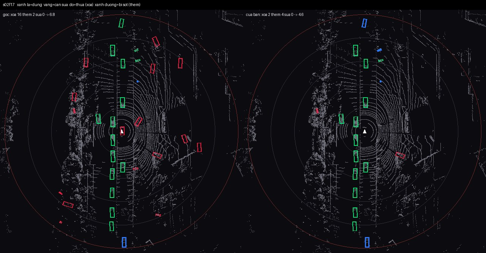

# Báo cáo Day 14 — Ha Khanh — 2A202603221

- Mã học viên dùng với `--student`: `2A202603221`
- `seed_tag` trong `frames_A.txt`: `393590736f`

## 1. Dự đoán trước sweep (bước 5b)

Ghi **trước** khi chạy `scripts/pp_sweep.py`, rồi commit và push ngay (lịch sử commit là bằng chứng thời điểm viết). Không sửa phần này sau khi có kết quả.

- Tham số tôi nghĩ giảm công sửa nhiều nhất: Tăng `score_thr` (từ `0.1` lên khoảng `0.3`–`0.4`), mạnh hơn đáng kể so với tăng `min_points`.
- Vì sao (nhìn ảnh BEV tập A: box thừa nhiều hay box sót nhiều?): Trên 3 ảnh BEV và kết quả đo cấu hình gốc tập A (`GT 46`, `dự đoán 77`, `xóa 36`, `thêm 5`, `sửa 2`, chi phí `16.8`), số box thừa cần xóa (`36` box, chiếm `10.8/16.8` tổng chi phí) áp đảo số box bị sót (`5` box). Nhiều box thừa trên vỉa hè, bụi cây, dải phân cách, hàng rào và trên chính xe ego có điểm tin cậy thấp (`22/77` box có `score < 0.4`, trong đó `11/77` box có `score < 0.3`), trong khi gần như toàn bộ box đều có nhiều điểm LiDAR (`chỉ 1/77` box có `npts < 5` và `4/77` box có `npts < 10`) nên lọc `min_points` khó loại được nhiều box nhiễu. Tuy nhiên, nếu đẩy `score_thr` lên quá cao (như `0.5`) có thể làm rơi mất các vật thật có score thấp (ví dụ `Cyclist` `pp_id=22` ở `s04f14` có `score=0.21` hay `Truck` `pp_id=17` ở `s03f09` có `score=0.36`), mà mỗi vật bị sót phải cộng thêm `1.0` điểm nên sẽ nhanh chóng triệt tiêu lợi ích xóa nhiễu (`0.3`/box).

## 2. Tập A: sửa tay và tune

| Cấu hình | Xóa | Thêm | Sửa | Chi phí |
|---|---:|---:|---:|---:|
| Gốc | 36 | 5 | 2 | 16.8 |
| `best_config.json` | 7 | 10 | 1 | 12.6 |

- Tham số đã đổi trong `best_config.json`: `score_thr: 0.1 -> 0.5` (`min_points` giữ nguyên `0`).
- Kết quả leave-one-out (dán các dòng `scripts/pp_sweep.py` in ra):
  ```text
  s02f17: cấu hình chọn {'score_thr': '0.5', 'min_points': '0'} → 4.6 (tốt nhất có thể 4.6)
  s03f09: cấu hình chọn {'score_thr': '0.5', 'min_points': '0'} → 5.4 (tốt nhất có thể 4.5)
  s04f14: cấu hình chọn {'score_thr': '0.5', 'min_points': '0'} → 2.6 (tốt nhất có thể 2.6)
  ```
- Cấu hình có ổn định trên từng frame không? Vì sao tôi vẫn chọn (hoặc không chọn) nó: Khá ổn định trong phạm vi 3 frame tập A — cả 3 lượt leave-one-out đều chọn đúng một cấu hình `score_thr=0.5, min_points=0`, đạt đúng mức tốt nhất có thể (oracle) trên `s02f17` (`4.6/4.6`) và `s04f14` (`2.6/2.6`), chỉ cao hơn oracle `0.9` điểm trên `s03f09` (`5.4` vs `4.5`, ngang bằng cấu hình gốc `5.4` vì `score_thr=0.5` bỏ sót thêm 2 xe score `0.34–0.36`). Tôi vẫn chọn `best_config.json` cho tập B vì giảm chi phí rõ trên 2/3 frame và không làm xấu hơn ở frame còn lại, đồng thời giữ `min_points=0` để không đánh rơi các vật ở xa có ít điểm LiDAR.

## 3. Trước/sau (bước 8)



- `scripts/pp_compare.py` báo giảm **25%** công sửa trên tập A (`16.8` xuống `12.6`; từng frame: `s02f17` `6.8 -> 4.6`, `s03f09` `5.4 -> 5.4`, `s04f14` `4.6 -> 2.6`).
- Dự đoán ở mục 1 đúng hay sai? Giải thích bằng số box xóa/thêm/sửa: **Đúng về hướng chính nhưng lệch một phần về ngưỡng tối ưu.** Dự đoán tăng `score_thr` hiệu quả hơn hẳn `min_points` là đúng: tại `score_thr=0.1`, tăng `min_points` lên `5` chỉ giảm chi phí từ `16.8` xuống `16.5` (bớt đúng 1 hộp xóa), còn lên `10` lại tăng lên `17.7`; tại `score_thr=0.5`, cả 3 mức `min_points=0/5/10` đều cho cùng chi phí `12.6`. Tuy nhiên, ở mục 1 tôi đoán ngưỡng tốt nhất dừng ở `0.3–0.4` vì lo `0.5` làm rơi quá nhiều vật thật (`+1.0`/hộp); thực tế khi tăng từ `0.4` lên `0.5`, số hộp cần **thêm** chỉ tăng từ `9` lên `10` (`+1.0`) trong khi số hộp cần **xóa** giảm mạnh từ `18` xuống `7` (`-3.3`), nên tổng chi phí vẫn giảm tiếp từ `14.9` xuống `12.6`. So với cấu hình gốc (`0.1`): **xóa** giảm `36 -> 7` (tiết kiệm `8.7`), **sửa** giảm `2 -> 1` (tiết kiệm `0.5`), **thêm** tăng `5 -> 10` (tốn thêm `5.0`), tổng giảm ròng `4.2` điểm (`25%`).

## 4. Tập B

Số đo từ `scripts/pp_prelabel.py --frames d14_2A202603221/frames_B.txt --config d14_2A202603221/best_config.json --gt d14_2A202603221/ref_B.json` (`GT 116`, `dự đoán 165`, `khớp 106` trên đủ 12 frame):

| Xóa | Thêm | Sửa | Chi phí |
|---:|---:|---:|---:|
| 59 | 10 | 3 | 29.2 |

- Loại box tốn công sửa nhất ở tập B:
  - Xét theo tổng đóng góp vào công thức chi phí: **box thừa cần xóa** (`59` box = `17.7/29.2` điểm, chiếm ~60,6% tổng chi phí), chủ yếu là dương tính giả lớp `Car`/`Cyclist`/`Pedestrian` bám trên hàng rào, dải phân cách, bụi cây hoặc xe hai bánh dựng ven đường không có người lái (nhiều nhất ở `s01f36`: 9 xóa, `s01f17` và `s05f35`: 8 xóa).
  - Xét theo mức độ tốn công trên từng vật thể: **xe cỡ lớn `Bus` và `Truck`** (`10` box bị sót phải thêm mới = `10.0` điểm, chủ yếu là xe buýt ở `s01f17`, `s02f10`, `s04f08`, `s04f30` và xe tải ben hạng nặng ở `s04f08`, `s05f17`; cộng thêm `3` box phải sửa mạnh lớp/kích thước gồm van chở hàng ở `s02f10`, xe tải ben ở `s05f00` bị cắt nhỏ thành `Car`, và 1 người đi xe máy `Cyclist` bị gán nhầm thành `Car` ở `s04f30`).

## 5. Giới hạn

- **Số frame tune quá ít (chỉ 3 frame tập A):** Dù kết quả leave-one-out trên tập A khá nhất quán ở `score_thr=0.5`, khi áp dụng sang 12 frame tập B vẫn còn 59 hộp thừa có `score >= 0.5` và đồng thời bỏ sót một số phương tiện thật ở mức score dưới `0.5`.
- **Lệch miền dữ liệu KITTI → VF:** PointPillars được huấn luyện trên KITTI (LiDAR 64 tia, góc nhìn phía trước, chỉ có 3 lớp `Car`/`Cyclist`/`Pedestrian`), không có lớp `Bus` và `Truck`, nên trên dữ liệu VF 360° bỏ sót phần lớn xe buýt/xe tải nặng hoặc chỉ tạo hộp nhỏ trên một phần đầu xe và hay nhận nhầm bụi cây/hàng rào thành xe.
- **Công thức chi phí chưa phải thời gian sửa thật:** Chỉ số `0.3·xóa + 1.0·thêm + 0.5·sửa` là công thức xấp xỉ do bài lab đặt để so sánh giữa các cấu hình, không thể quy đổi thành "tiết kiệm X giờ công" vì chưa đo thời gian thao tác thực tế của người gán nhãn trên CVAT.
- **Ghi chú công cụ hỗ trợ (theo `RULES.md`):** Ngoài pipeline pre-label mặc định của lab, quá trình kiểm duyệt tập A và tập B có sử dụng script nội bộ chiếu hộp từ `calib.json` lên ảnh 7 camera độ phân giải cao kết hợp đối chiếu cụm điểm LiDAR và `scripts/vf_qa.py` để rà soát hộp nhiễu/hộp sót, đẩy bản cập nhật `Shape` lên CVAT rồi kiểm tra trực quan lại toàn bộ ảnh chiếu 7 camera trước khi xuất `ref_A.json` và `ref_B.json`.
